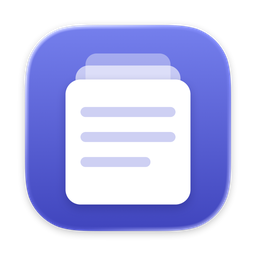
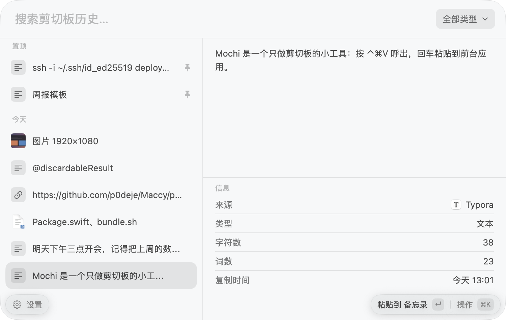
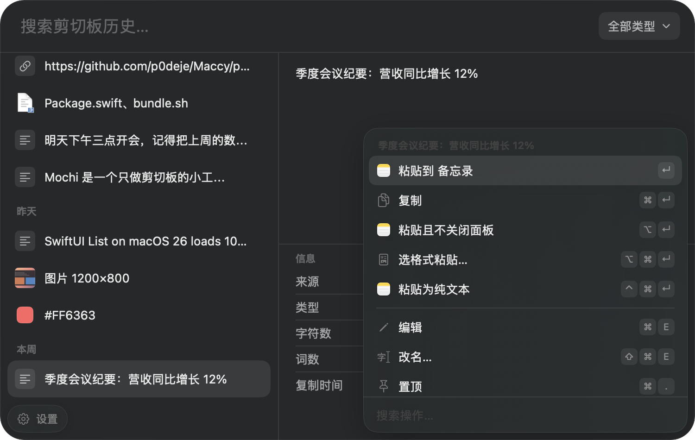

<p align="center"></p>

<h1 align="center">Mochi</h1>

<p align="center">Clipboard history for macOS, and nothing else.</p>

<p align="center">English · <a href="README.zh-CN.md">简体中文</a></p>

Mochi keeps what you copy (text, images, and files) and brings it back with a keyboard shortcut. The panel and its shortcuts follow Raycast's Clipboard History, so if you are used to that, Mochi works the same way. It is a native Swift app (AppKit and SwiftUI) with no third-party dependencies, and it uses about 15 MB of memory while idle.

The interface is in Simplified Chinese.



## Features

- **Opens with ⌃⌘V** (configurable). The panel floats over the app you are using without taking focus from it, on the screen with the mouse pointer, also over full-screen apps.
- **Search and filter.** Type to search text and file names. Filter by text, images, files, links, emails, or colors (⌘P). Entries are grouped into Pinned, Today, Yesterday, This Week, and Earlier.
- **Preview** of the full text, images, files, and colors, with the source app, size, and the time it was copied.
- **Paste** into the app you were using (↵), copy only (⌘↵), paste and keep the panel open (⌥↵), paste as plain text (⌃⌘↵), or paste one stored format such as RTF or HTML (⌥⌘↵). Settings can make ↵ copy instead.
- **⌘K actions** for the selected entry, also on right-click: open a link or file, open with another app, show in Finder, Quick Look, edit text, rename, pin and reorder pins, delete, delete the last few minutes, clear.
- **⌘1 … ⌘0** act on the first ten entries; hold ⌘ to see the numbers. Drag an entry into another app.
- **Paste sequentially.** A second global shortcut pastes your recent clips one after another, newest first.
- **Privacy.** Content marked as concealed or transient, which password managers do, is never recorded. Apps you list are ignored; Keychain Access and Passwords are ignored by default. Recording can be paused. History is kept for 3 months by default, configurable from 1 hour to forever. Your history never leaves your Mac. The only network request Mochi makes is the update check below.
- **Updates.** Once a day Mochi asks GitHub whether there is a newer release; you can turn this off in Settings. When there is one, click 更新 (Update) and Mochi downloads it, checks that it is signed with the same certificate, replaces itself, and restarts.



## Shortcuts

| Keys | Action |
| --- | --- |
| ⌃⌘V | Open or close the panel |
| ↑ ↓ · ⌘↑ ⌘↓ | Move · jump between groups |
| ↵ | Paste into the front app |
| ⌘↵ | Copy |
| ⌥↵ | Paste and keep the panel open |
| ⌃⌘↵ | Paste as plain text |
| ⌥⌘↵ | Paste a chosen format |
| ⌘K | Actions |
| ⌘P | Filter by type |
| ⌘. | Pin or unpin |
| ⌥⌘↑ ⌥⌘↓ | Move a pinned entry up or down |
| ⌘E · ⇧⌘E | Edit text · rename |
| ⌘O | Open the link or file |
| ⇧⌘O | Show in Finder |
| ⌘Y | Quick Look |
| ⌃X | Delete |
| ⇧⌘X | Delete entries from the last few minutes |
| ⌃⇧X | Clear history (pinned entries stay) |
| ⌘1 … ⌘0 | Act on entry 1 to 10 |
| ⌘, | Settings |
| ⌘Q | Quit Mochi |
| Esc | Clear the search, then close the panel |

## Requirements

- macOS 26 or later.
- Accessibility permission, so that Mochi can press ⌘V for you. Without it, ↵ only copies and you paste yourself. Mochi asks for it the first time; you can also turn it on in System Settings › Privacy & Security › Accessibility.

Mochi has no Dock icon. It lives in the menu bar. If the menu bar icon is hidden, the 设置 (Settings) button at the bottom left of the panel opens the settings and can quit the app.

## Install

Download `Mochi-<version>.zip` from [Releases](../../releases), unzip it, and move Mochi.app to Applications.

Mochi is not notarized by Apple, so macOS blocks it the first time you open it. Go to System Settings › Privacy & Security and click Open Anyway, or run:

```sh
xattr -dr com.apple.quarantine /Applications/Mochi.app
```

## Build from source

You need Xcode 26, or the Command Line Tools for Xcode 26.

```sh
git clone <this repository>
cd mochi
scripts/test.sh             # unit tests
scripts/bundle.sh release   # builds build/Mochi.app
open build/Mochi.app
```

`scripts/bundle.sh` signs the app with a certificate named "Mochi Development" if your keychain has one, and ad hoc otherwise. macOS ties the Accessibility permission to the signature, so with ad hoc signing you have to grant it again after every build. To avoid that, create a self-signed code signing certificate named Mochi Development in Keychain Access (Certificate Assistant › Create a Certificate…, certificate type Code Signing).

GitHub Actions builds and tests every push. Pushing a tag that starts with `v`, such as `v0.2.0`, publishes a release with the zipped app. Releases have to be signed with the certificate stored in the repository secrets `MOCHI_CERT_P12` (the certificate and its private key as a base64 .p12) and `MOCHI_CERT_PASSWORD`, because Mochi only updates to versions signed with the same certificate; without them the release build fails.

The app icon is drawn by `scripts/icon.swift`.

## Where the data is

History is stored in `~/Library/Application Support/com.blueocean223.mochi/`: one SQLite database and a folder of images. Quit Mochi and delete that folder to start over.

## Project layout

- `Sources/MochiCore`: reading the pasteboard, deciding what kind of content it is, storage (SQLite through the system's libsqlite3), and images. Tested in `Tests/MochiCoreTests`.
- `Sources/Mochi`: the app: menu bar item, panel, settings window, global shortcuts, pasting, updates.
- `scripts`: build, test, and icon scripts.

## Acknowledgements

The panel, the shortcuts, and most of the behavior follow [Raycast](https://www.raycast.com)'s Clipboard History. Mochi is not affiliated with Raycast.

## License

[MIT](LICENSE)
